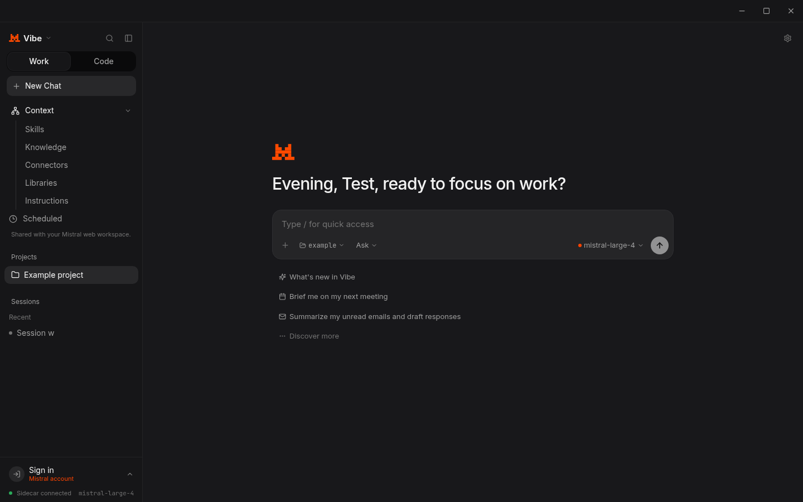
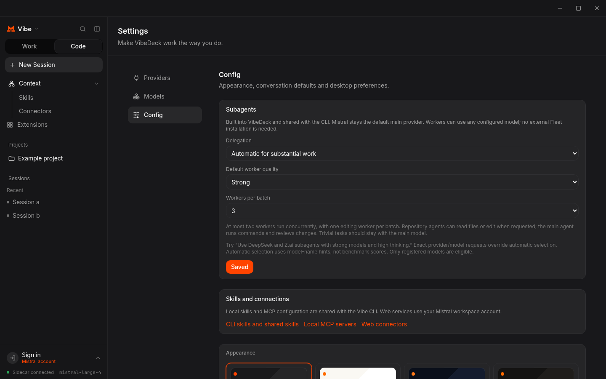
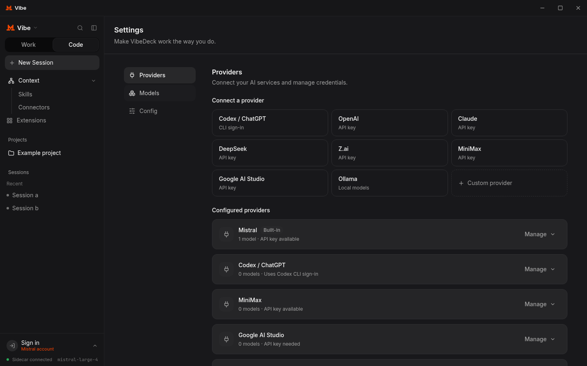
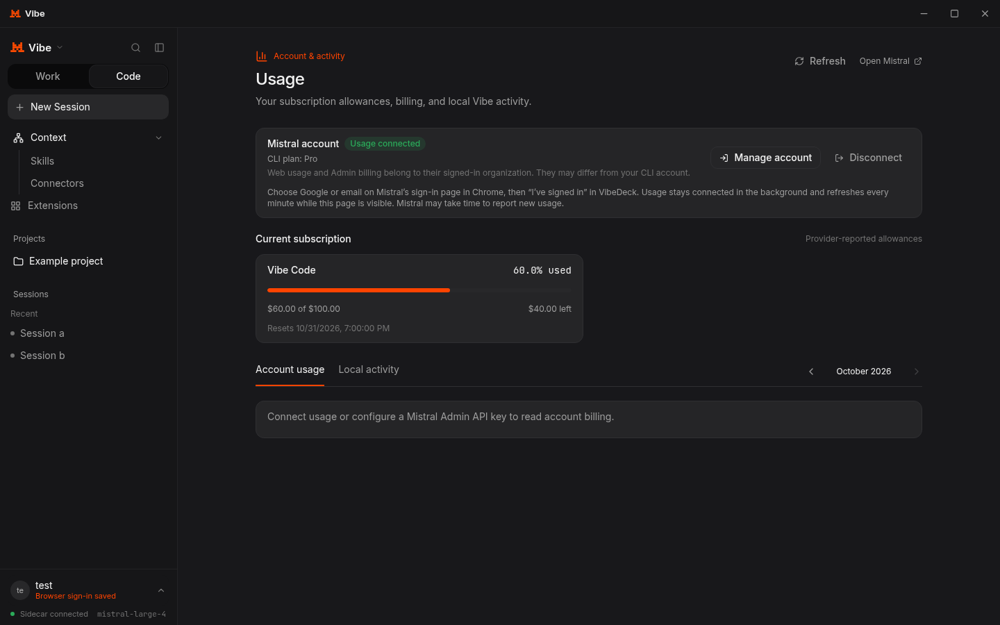

# VibeDeck

**Created by OSINTCabal**

Version **1.0.0**, the first release.

A Mistral Vibe desktop app for **Fedora and Debian Linux**. Chat, write code, and pick up your coding sessions in the Vibe CLI. Mistral is the default provider.

[Install](docs/INSTALL.md) · [Development](docs/DEVELOPMENT.md) · [Verification](docs/VERIFICATION.md)



## Features

Chat with streamed responses and visible model thinking, approve tool calls, and use Skills and MCP from the desktop. Coding sessions and local settings are shared with the Vibe CLI. Add other providers as your main model or use them as subagents.

Code mode includes Ask, Plan, Accept edits, and Full auto. Built-in subagents work with Mistral and your other configured models.

Skills, Knowledge, Connectors, Libraries, Instructions, and Scheduled open your Mistral web workspace inside the app. Docs and Admin open there too. Sign in with Google or email through Chrome or Chromium; the connection stays saved across launches. Connectors also lists local CLI MCP servers. Settings covers providers, models, local configuration, zoom, and seven themes.

## How it works

1. **Desktop and CLI:** A local service runs Vibe coding sessions. Both share the CLI's session files and configuration. Finish a turn in one, then continue in the other.
2. **Web workspace:** Context pages save to your Mistral account. Local chats, CLI skills, and MCP servers stay separate and are not automatically uploaded.
3. **Providers and agents:** Add credentials and models in Settings, pick your main model, and ask it to delegate. Workers use your configured providers and their billing.

## Providers

| Provider | Connection |
| --- | --- |
| Mistral | Vibe CLI credentials; API key for local API tools |
| Codex / ChatGPT | Official Codex CLI browser sign-in through the local bridge |
| OpenAI / Codex API | API key, OpenAI Responses |
| Claude | API key, Anthropic Messages |
| DeepSeek | API key, OpenAI-compatible |
| Z.ai | API key, OpenAI-compatible |
| MiniMax.io | Token Plan or API key, OpenAI-compatible |
| Google AI Studio | Gemini API key, OpenAI-compatible |
| Ollama | Local OpenAI-compatible endpoint, no key required |

Add custom providers in **Settings → Providers** using a base URL, model ID, and optional API key. Register models in **Settings → Models**.

| Custom API format | Settings value |
| --- | --- |
| OpenAI Chat Completions | `openai` |
| OpenAI Responses | `openai-responses` |
| Anthropic Messages | `anthropic` |
| Vibe reasoning-compatible | `reasoning` |

Tool calling, reasoning, and subagent delegation depend on the model. MiniMax plan and API quotas are separate. Z.ai Coding Plan access depends on its supported-tool policy.

## Subagents

Choose **Settings → Config → Subagents** for delegation on request, automatic delegation for substantial work, or Off. Set worker quality and the batch limit there.

Ask “Send off subagents to review this” or “Use DeepSeek and Z.ai agents with strong models and high thinking.” Named providers, model aliases, and thinking levels are respected. Automatic selection uses model-name and task hints rather than benchmark rankings.

Workers can review context, read files, or edit when requested. The main agent runs commands and checks their work. Two workers can run at once, with one editing worker per project. Jobs have token and time limits. Failed jobs do not retry or switch providers automatically.



## Installation

Fedora and Debian use **one repository and the same Electron installer**. Follow the [installation guide](docs/INSTALL.md) for system packages, runtime dependencies, and Vibe CLI setup, then run:

```bash
bash packaging/install.sh
vibedeck
```

Verified on Fedora 44 and Debian 12. Linux Mint has not had a separate desktop test. Tauri packages are older experimental builds without the full Electron workspace and browser connection.

## Screenshots

Provider settings:



Subscription usage:



Screenshots use isolated sample workspaces. See [more screenshots](docs/screenshots).

## Notes

- The bottom-left account menu handles browser sign-in, account switching, and sign-out. CLI credentials and API keys are separate.
- **Connect services** completes web connector authorization through the browser. Local MCP servers share the CLI configuration; they are not automatically registered as web connectors.
- Local chats and files are not automatically uploaded to the web workspace. API tools use API billing, separate from your Vibe subscription. Viewing usage or local connectors makes no model requests.

## Coming soon

Full Mistral Studio integration and more desktop features are planned. For now, Studio opens in your browser from the Vibe menu.
